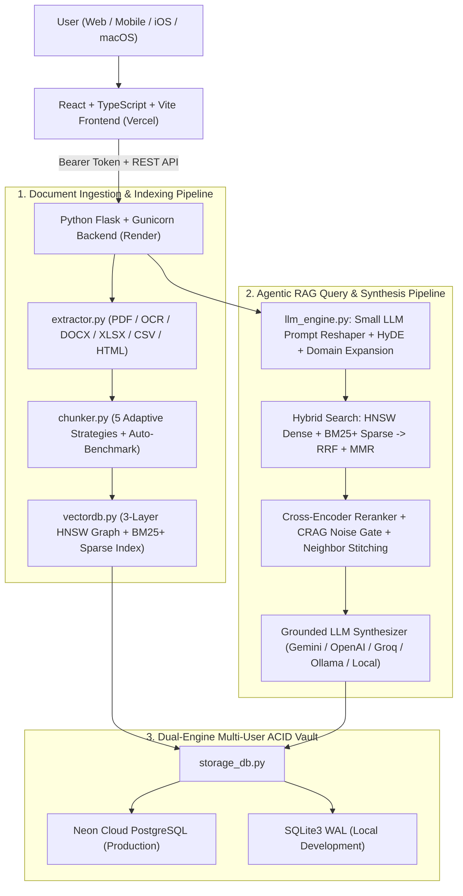

# RAG_BUDDY — Project Architecture, Features & Engineering Documentation

> **Live Frontend (Vercel):** `https://your-rag-assistant.vercel.app`  
> **Live Backend API (Render):** `https://clayrag-backend.onrender.com`  
> **Cloud Database:** Neon PostgreSQL (`DATABASE_URL` with automatic SQLite3 WAL local fallback)  
> **Repository:** `https://github.com/iGNI3/your_rag_assistant`

---

## 1. Executive Summary — What We Built

**RAG_BUDDY** is a full-stack, multi-user **Agentic Retrieval-Augmented Generation (RAG) Workflow Studio**. Unlike a black-box chatbot, RAG_BUDDY combines a production conversational AI assistant with a transparent, glass-box inspection studio that lets users upload complex documents (PDFs, scanned images via OCR, DOCX, XLSX, CSV, Markdown, HTML), inspect how documents are chunked and embedded in vector space, monitor every retrieval and reranking metric in real time, and verify every answer directly inside an interactive **Full Document Reader** with table reconstruction and inline source highlighting.

---

## 2. System Architecture — How the Platform Works End-to-End



### Step-by-Step Query Lifecycle
1. **User Authentication & Workspace Isolation**: Every request is authenticated with a per-user session bearer token (`Authorization: Bearer <token>`). Documents, vector chunks, chat sessions, query history, saved findings, and API keys are strictly isolated by `user_id`.
2. **Document Extraction & Normalization (`backend/extractor.py`)**:
   - Extracts raw text and native Markdown tables from **PDF** via **`pdfplumber`** (native X/Y coordinate layout + table grid extraction with automatic `pypdf` fallback), **Word** (`python-docx`), **Excel/CSV** (`openpyxl` / `csv`), **HTML** (`BeautifulSoup`), **Images/OCR** (`Pillow` + `pytesseract`), and **Markdown/JSON/Text**.
   - Runs `optimize_and_clean_text()` to normalize Unicode ligatures, de-hyphenate wrapped words, strip pagination noise, and compute extraction telemetry.
3. **5-Strategy Adaptive Chunking (`backend/chunker.py`)**:
   - Benchmarks all 5 strategies (**Semantic Inflection**, **Hierarchical Parent-Child**, **Atomic Fact Propositions**, **Structural AST & Table**, and **Sliding Window**) on coherence, boundary sharpness, density, and uniformity, automatically selecting the winning strategy (or letting the user override it).
   - Preserves original document line breaks (`\n`) inside parent and child chunks.
4. **Hybrid Indexing (`backend/vectordb.py`)**:
   - Indexes every chunk into a **3-Layer HNSW dense vector graph** (supporting Cosine, Dot Product, Euclidean, and Manhattan distance metrics) alongside a **BM25+ sparse lexical index** (`k1 = 1.5, b = 0.75`) and computes 2D manifold coordinates for visual inspection.
5. **Agentic Prompt Reshaping & Domain Expansion (`backend/llm_engine.py`)**:
   - Detects conversational greetings naturally (e.g., `"Hi"` responds cleanly without dumping raw document chunks).
   - Expands everyday questions into formal document/policy terminology (e.g., mapping `"LASIK surgery next month"` to `"refractive error"`, `"cosmetic or plastic surgery"`, `"Code Excl08"`, `"waiting period"`, `"day care"`).
   - Generates a **Step-Back Query**, **3 Multi-Query Sub-Queries**, and a **HyDE (Hypothetical Document Embedding)** passage, using up to 3 previous turns from the *same* `chatId` for conversational memory.
6. **Hybrid RRF Retrieval, Cross-Encoder Reranking & CRAG Gating**:
   - Combines HNSW dense ranks and BM25+ sparse ranks using **Reciprocal Rank Fusion (RRF)** and **Maximal Marginal Relevance (MMR)** diversity filtering.
   - Prioritizes user-uploaded documents over starter demo whitepapers so custom documents always surface first.
   - Reranks top candidates via Cross-Encoder scoring, filters irrelevant noise through the **Corrective RAG (CRAG) Noise Gate**, and stitches adjacent neighbor chunks so multi-paragraph clauses are never cut off mid-sentence.
7. **Grounded Synthesis, SSE Live Token Streaming & Verification**:
   - Routes generation to the user's configured provider (**Gemini**, **OpenAI**, **Groq**, **OpenRouter**, **Anthropic**, **Ollama**, **LM Studio**, or built-in offline extractive synthesis) with automatic model-slug normalization and fallback retries.
   - Streams real-time stage events (`stage`, `retrieval`), live token deltas (`token`), and finalized telemetry (`done`) over **Server-Sent Events (`POST /api/query/stream`)** so Markdown tables, headings, and inline `[Source X]` citations type out live in the UI, followed by Self-RAG claim verification and evaluation metrics (`NDCG@K`, `MRR`, `Groundedness`, `Optimization Index`).

---

## 3. Why We Chose NOT to Use LangChain

A deliberate engineering decision was made to build `RAG_BUDDY`'s core pipeline in **clean, modular Python** instead of using LangChain.

### Key Reasons
| Engineering Factor | Custom Pure-Python Pipeline (Our Choice) | LangChain Framework |
| :--- | :--- | :--- |
| **Glass-Box Observability & Telemetry** | Direct access to every intermediate score: HNSW layer hops, Dense vs. BM25+ RRF scores, Cross-Encoder rank deltas (`+1`, `+2`), CRAG grades, HyDE coordinates, and per-stage millisecond latency. | Internals are hidden behind abstract `RunnableSequence` / `Retriever` wrappers; extracting per-step telemetry requires custom callbacks and subclassing. |
| **Memory & Free-Tier Hosting (Render 512 MB RAM)** | Tiny dependency footprint (`Flask`, `pypdf`, `python-docx`, `openpyxl`, `psycopg`). Fast cold starts and low memory usage on Render's free tier. | Pulling `langchain`, `langchain-community`, provider packages, and vector plugins installs 50–100+ transitive dependencies that easily hit 512 MB RAM limits. |
| **Stability & Maintainability** | Plain, readable Python functions (`extractor.py`, `chunker.py`, `vectordb.py`, `llm_engine.py`) with zero breaking framework migrations. | Frequent breaking changes across `0.1` -> `0.2` -> `0.3` -> `1.0` releases and Pydantic version conflicts. |
| **Multi-Provider Support Without SDK Lock-In** | Direct HTTP JSON calls support Gemini, OpenAI, Groq, OpenRouter, Ollama, and LM Studio with automatic slug normalization and retry fallbacks. | Requires installing and maintaining separate partner SDKs (`langchain-google-genai`, `langchain-openai`, `langchain-groq`, etc.). |
| **Custom Domain & UI Precision** | Custom features like per-user multi-tenant SQLite/PostgreSQL scoping, domain concept expansion, neighbor-chunk stitching, and exact character-offset highlighting in the Document Reader take 15–40 lines of clear Python. | Fighting framework abstractions often requires more boilerplate than writing the logic directly. |

### Where Specialized Libraries *Do* Help
- **PDF Table Extraction**: LangChain itself uses `pypdf` under the hood (`PyPDFLoader`), so LangChain would not have solved complex PDF table grids on its own. Instead, we plugged **`pdfplumber`** directly into `backend/extractor.py` for lightweight (~40 MB RAM), native X/Y coordinate Markdown table extraction that still fits Render's 512 MB free tier (whereas `Docling` requires 1.5–3 GB RAM + PyTorch).
- **Neural Embeddings & Managed Vector Search**: Plugging Gemini/OpenAI embeddings + `pgvector` directly into Neon PostgreSQL can be added in ~30 lines of Python without adopting a heavy orchestration framework.
- **When LangChain / LangGraph Makes Sense**: When an app needs 30+ pre-built SaaS connectors (Confluence, SharePoint, Notion, Jira, Slack) or complex branching multi-agent state machines (`LangGraph`).

---

## 4. Complete Feature Inventory

### A. Conversational AI Chat & Multi-Session History
- **Per-User Multi-Conversation Chat History**: Create (`+ NEW CHAT`), switch between saved conversations, **inline rename** (from both the Left Sidebar and the Chat Top Bar), and delete individual conversations—persisted in Neon PostgreSQL and SQLite3.
- **Auto-Named Conversations & Scoped Memory**: New chats automatically title themselves from your first prompt, and 3-turn conversational memory is strictly isolated per `chatId`.
- **Live 4-Stage Answering Animation**: Instant user prompt bubble + animated 4-bar equalizer wave, live elapsed timer, 4-step pipeline progress pills (`01 RESHAPE` -> `02 HNSW + BM25+` -> `03 CRAG RERANK` -> `04 LLM SYNTHESIS`), and shimmer skeleton lines while the LLM generates.
- **Rich Markdown & Table View in Chat**: Renders headings, code blocks with one-click Copy, bullet lists, clickable inline `[SOURCE X]` citation pills, and structured HTML tables (supporting both standard pipe tables and quoted PDF/policy tables).
- **Direct Document / OCR Attachment in Chat**: Upload PDFs, images, DOCX, XLSX, CSV, HTML, or Markdown directly from the chat composer dock.

### B. Interactive Source Citations & Floating Full Document Reader
- **Hover Instruction Tooltips**: Hovering over any inline `[SOURCE X]` pill or bottom `SOURCES: [X]` badge displays a tooltip instructing the user to click to preview and highlight the exact passage.
- **Floating Full Document Reader Window**:
  - Opens the **complete continuous document** (not isolated chunk cards) rendered from the original extracted text.
  - **Auto-Centers on Highlight First**: Immediately scrolls to the cited passage on open so the user sees the highlighted section first, then can scroll up or down for the full surrounding document context.
  - **PDF Table Reconstruction & Row-Level Highlighting**: Unwraps vertically wrapped PDF table cells and renders Customer Information Sheets, Policy Schedules, Co-Insurance/Instalment tables, Exclusions, Waiting Periods, and Schedules of Benefits as real HTML tables—highlighting the exact cited table rows directly inside the table.
  - **Quick Source Switcher & Center Button**: Switch between all cited sources (`SOURCE #1`, `SOURCE #2`, ...) or click **CENTER ON HIGHLIGHT** at any time.

### C. 9-Page Agentic RAG Studio
1. **Page 01 — Chat Assistant (Home)**: Full conversational RAG interface with locked viewport layout and independent message scroll.
2. **Page 02 — Pipeline Architecture**: Visual choreographer of all RAG pipeline stages and real-time status.
3. **Page 03 — Document & OCR Ingest**: Drag-and-drop multi-format ingestion, extraction telemetry, and corpus management.
4. **Page 04 — 5-Strategy Chunking**: Live comparison and re-chunking across all 5 chunking strategies with composite quality benchmarks.
5. **Page 05 — 2D Vector Manifold**: Interactive 2D scatter visualization of document chunks, user query vector, and HyDE anchor vector.
6. **Page 06 — Prompt & CRAG Inspector**: Deep audit of Small LLM prompt reshaping, multi-queries, HyDE document, Cross-Encoder reranking, and CRAG pruned noise chunks.
7. **Page 07 — Evaluation Metrics**: Groundedness, NDCG@K, MRR, Context Precision, and latency breakdown charts.
8. **Page 08 — SQLite / PostgreSQL Vault & Findings**: Database telemetry and saved research findings (exported as Markdown).
9. **Page 09 — Settings & Account**: Provider selection (Gemini, OpenAI, Groq, OpenRouter, Ollama, LM Studio, Offline GGUF), encrypted/masked API keys, RAG hyperparameters, and profile/password management.

### D. Design System, Themes & Cross-Device Responsiveness
- **3 Material Themes × 9 Color Palettes**:
  - **Tactile Clay** (warm matte clay surfaces with soft extruded depth)
  - **Vision Ceramic** (Apple Vision Pro porcelain white + deep botanical emerald + sunlit apricot bento studio)
  - **Frosted Crystal Liquid Glass** (iDraft-inspired frosted frame over 3D satin-silk ribbons + pure white sidebar + obsidian bento cards)
- **Performance Optimized**: Zero nested `backdrop-filter: blur()` stacks, zero heavy SVG drop-shadow filters, and GPU-composited transitions for smooth 60fps scrolling.
- **Full Desktop, Tablet, Mobile, macOS & iOS Safari Support**: Locked desktop sidebar + isolated chat scroll (`>= 1025px`), sticky mobile top bar + slide-over navigation drawer (`<= 1024px`), stacked mobile chat composer (`<= 640px`), and iOS safe-area insets.

---

## 5. Project Structure & Key Files

| Path | Role |
| :--- | :--- |
| `backend/main.py` | Flask REST API server, auth middleware, RAG pipeline orchestrator, and `/api/chats` endpoints |
| `backend/storage_db.py` | Dual-engine ACID database layer (Neon PostgreSQL + SQLite3 WAL) for all 8 tables (`users`, `sessions`, `documents`, `vector_chunks`, `chat_sessions`, `query_runs`, `saved_findings`, `pipeline_config`) |
| `backend/extractor.py` | Multi-format document & OCR extractor (PDF, DOCX, XLSX, CSV, HTML, Images, Markdown) |
| `backend/chunker.py` | 5-strategy adaptive chunking engine and automated strategy benchmarker |
| `backend/vectordb.py` | 3-layer HNSW vector graph + BM25+ sparse index + RRF/MMR hybrid retrieval + Cross-Encoder reranking |
| `backend/llm_engine.py` | Prompt reshaper, domain concept expansion, HyDE synthesis, multi-provider LLM router, and claim verification |
| `src/App.tsx` | Main React shell, authentication gate, 9-page router, theme engine, and sidebar Chat History UI |
| `src/pages/ChatHomePage.tsx` | Conversational chat thread, live 4-stage answering animation, and Floating Full Document Reader with PDF table parser |
| `src/components/RichMarkdownRenderer.tsx` | Markdown renderer with clickable `[SOURCE X]` citation tooltips, code copy blocks, and HTML table rendering |
| `src/styles/clay.css` | Complete design system for all 3 material themes, responsive layouts, animations, and document reader tables |
| `src/themePalettes.ts` | Definitions for the 9 curated color palettes across all 3 material modes |
| `render.yaml` / `vercel.json` | Production deployment manifests for Render (backend) and Vercel (frontend) |

---

## 6. Script-by-Script & Function-by-Function RAG Reference

This section maps **every backend and frontend script** and its **exact functions** to the specific RAG job it performs.

### 6.1 `backend/extractor.py` — Document Ingestion, OCR & Text Cleaning
Handles raw file parsing across 10+ formats and prepares clean text before chunking.

| Function | Responsibility in the RAG Pipeline |
| :--- | :--- |
| `_extract_pdf_with_pdfplumber()` & `_table_rows_to_markdown()` | Native X/Y bounding-box PDF layout & table extractor via **`pdfplumber`**. Deduplicates nested outer wrapper boxes, converts native PDF tables into clean Markdown pipe tables, and interleaves prose and tables in true top-to-bottom reading order. |
| `extract_document_from_bytes()` | Master file router: inspects file extension/MIME type and extracts raw text/tables from **PDF** (`pdfplumber` with `pypdf` fallback), **DOCX** (`python-docx`, including Markdown table conversion), **XLSX/CSV/TSV** (`openpyxl` / `csv`), **HTML/XML** (`BeautifulSoup`), **Images** (OCR), and **Markdown/JSON/Text**. |
| `_run_image_ocr()` | Runs visual OCR on uploaded images (`.png`, `.jpg`, `.webp`, `.tiff`) using `Pillow` + `pytesseract` (if installed), with embedded metadata and readable byte-stream fallback. |
| `optimize_and_clean_text()` | Normalizes Unicode ligatures (`fi`, `fl`, curly quotes), fixes cross-line hyphenation (`optim-\nization` -> `optimization`), strips control bytes and standalone page footers, compacts whitespace, and computes extraction telemetry (`noiseRemovedPct`, `detectedTables`, `detectedHeadings`, `estimatedTokens`). |

### 6.2 `backend/chunker.py` — 5-Strategy Adaptive Chunking & Auto-Benchmarking
Breaks cleaned documents into high-coherence retrieval chunks while preserving line breaks, headings, and tables.

| Function | Responsibility in the RAG Pipeline |
| :--- | :--- |
| `split_into_sentences_and_blocks()` | Parses document lines while keeping fenced code blocks (` ``` `), Markdown tables (`\| ... \|`), Markdown headings (`#`–`######`), and original newline markers (`startsNewLine`) intact. |
| `_run_semantic_chunking()` | Splits text at cosine similarity drops (`sentence_vector_similarity()`) between adjacent sentences and heading transitions. |
| `_run_hierarchical_chunking()` | Creates two linked tiers: large **Parent Macro Chunks** (for broad LLM context) and precision **Child Chunks** (for pinpoint HNSW matching), preserving line breaks in both. |
| `_run_proposition_chunking()` | Converts text into dense, self-contained atomic factual propositions with section context anchors. |
| `_run_structural_chunking()` | Preserves Markdown tables, code blocks, and structural AST boundaries without slicing mid-table. |
| `_run_sliding_window_chunking()` | Token-window chunking with configurable overlap (`overlap_tokens`) for unstructured transcripts. |
| `generate_chunks_by_strategy()` | Dispatcher that executes whichever of the 5 strategies is selected. |
| `benchmark_all_chunk_strategies()` | Runs all 5 strategies on an ingested document, scores each via `compute_chunk_metrics()`, `estimate_tokens()`, and `extract_top_keywords()`, and recommends the highest composite-scoring strategy. |

### 6.3 `backend/vectordb.py` — Hybrid HNSW + BM25+ Vector Database & Reranking Engine
Stores embeddings and sparse lexical indexes per user and runs the multi-stage retrieval pipeline.

| Function / Class | Responsibility in the RAG Pipeline |
| :--- | :--- |
| `compute_semantic_embedding()` | Generates unit-normalized semantic dense vectors for document chunks, queries, and HyDE passages. |
| `tokenize_for_sparse()` & `stem_word()` | Tokenizes and stems text into term-frequency maps for BM25+ lexical search. |
| `project_vector_to_2d()` | Projects high-dimensional chunk/query/HyDE vectors into 2D coordinates (`coords2D`) for the interactive 2D Vector Manifold visualization. |
| `compute_vector_similarity()` | Evaluates vector similarity across 4 configurable distance metrics: `cosine`, `dot`, `euclidean`, and `manhattan`. |
| `HybridVectorDatabase._compute_user_idf_and_hnsw()` | Builds each user's **3-layer HNSW proximity graph** and corpus-wide BM25+ IDF weights. |
| `HybridVectorDatabase.ingest_document()` & `rechunk_document()` | Runs chunking, computes embeddings + sparse terms + 2D coordinates, updates the in-memory HNSW graph, and persists everything via `storage_db.py`. |
| `HybridVectorDatabase.hybrid_retrieve_and_rerank()` | Core retrieval engine: executes dense HNSW search + sparse BM25+ search across primary, step-back, multi-query, and HyDE vectors; fuses ranks with **Reciprocal Rank Fusion (RRF)**; diversifies with **MMR**; prioritizes user-uploaded documents over starter demo docs (`_is_starter_seed_chunk()`); applies **Cross-Encoder reranking**; gates noise via **CRAG** (`HIGHLY_RELEVANT` / `PARTIAL_SUPPORT` / `IRRELEVANT_NOISE`); and performs **neighbor chunk stitching** so multi-paragraph clauses stay complete. |

### 6.4 `backend/llm_engine.py` — Prompt Reshaper, Domain Expansion, LLM Router & Synthesis
Handles query intelligence, external/local LLM routing, answer synthesis, and Self-RAG verification.

| Function | Responsibility in the RAG Pipeline |
| :--- | :--- |
| `_is_conversational_greeting()` | Detects casual greetings (`"Hi"`, `"Hello"`, `"Thanks"`) so the assistant replies naturally without dumping unrelated document chunks. |
| `_infer_domain_expansion_terms()` | Maps everyday user questions (e.g., `"LASIK surgery next month"`) to formal policy/domain terminology (`"refractive error"`, `"cosmetic or plastic surgery"`, `"Code Excl08"`, `"waiting period"`, `"day care"`). |
| `reshape_user_prompt()` | Small LLM Prompt Reshaper: classifies query intent and complexity, strips conversational noise, incorporates 3-turn chat history, and generates the reshaped primary query, step-back query, 3 sub-queries, and HyDE document. |
| `_resolve_effective_provider_and_model()` & `_normalize_gemini_model_candidates()` | Automatically routes API keys across providers and normalizes human-readable model labels (e.g., `"Gemini 2.5 Flash Lite"` -> `"gemini-2.5-flash-lite"`) with automatic fallback slugs. |
| `call_external_llm_if_available()` & `stream_external_llm_if_available()` | Zero-SDK HTTP clients (atomic JSON + live SSE/NDJSON streaming) calling **Gemini**, **OpenAI**, **Groq**, **OpenRouter**, **Anthropic**, **Ollama**, and **LM Studio**. |
| `synthesize_answer_and_verify()` & `stream_synthesize_answer_and_verify()` | Sends the retrieved context (wrapped in `<retrieved_sources>` prompt-injection delimiters), chat history, and 4-part analyst prompt (including Markdown Summary Table instructions and `[Source X]` citation rules) to the active LLM—streaming live token deltas in SSE mode; falls back to `_build_extractive_direct_answer()` if offline; then computes **Self-RAG claim verifications** and RAG metrics (`NDCG@K`, `MRR`, `Groundedness`, `Optimization Index`). |
| `scan_local_model_path()` & `inspect_model_file()` | Scans local directories for offline `.gguf` / `.safetensors` models for the Settings & Offline Model Portal. |

### 6.5 `backend/storage_db.py` — Dual-Engine PostgreSQL & SQLite3 Persistence Vault
Manages all 8 database tables, encryption, authentication, and multi-user chat history.

| Function / Class | Responsibility in the RAG Pipeline |
| :--- | :--- |
| `_DualConnection` & `_DualCursor` | Transparent database adapter that translates `?` placeholders to `%s` for **Neon PostgreSQL** while running natively on **SQLite3 WAL** locally. |
| `PersistentRAGDatabase._init_schema()` | Creates and safely migrates all 8 tables (`users`, `sessions`, `documents`, `vector_chunks`, `chat_sessions`, `query_runs`, `saved_findings`, `pipeline_config`). |
| `create_user()`, `authenticate_user()`, `create_session()`, `get_user_by_token()` | Multi-user account registration, PBKDF2-SHA256 password hashing (200k rounds), and bearer-token session authentication. |
| `_encrypt_secret()` & `_decrypt_secret()` | Encrypts stored provider API keys at rest inside `pipeline_config`. |
| `upsert_document_and_chunks()`, `load_all_documents_and_chunks()`, `delete_document()` | Persists and reloads user-scoped documents, raw/cleaned text, and vector chunks across server restarts. |
| `create_chat_session()`, `list_chat_sessions()`, `rename_chat_session()`, `delete_chat_session()` | Full CRUD for per-user multi-conversation chat history, including auto-titling (`_make_auto_chat_title()`) and legacy history migration (`_ensure_legacy_runs_have_chat_session()`). |
| `record_query_run()` & `load_query_history()` | Stores every RAG turn with full retrieval telemetry under its `chat_id` and loads scoped conversation memory. |
| `save_finding()`, `list_saved_findings()`, `delete_finding()` | Saves pinned RAG answers into the database and exports them as `.md` research notes. |

### 6.6 `backend/main.py` — Flask REST API & Pipeline Orchestrator
Exposes all HTTP endpoints, enforces per-user authentication, and wires the full RAG pipeline together.

| Function / Route | Responsibility in the RAG Pipeline |
| :--- | :--- |
| `require_auth()` | Decorator that validates `Authorization: Bearer <token>` on every workspace request and attaches `g.current_user`. |
| `execute_rag_pipeline()` | Master RAG orchestrator: loads 3-turn memory for the active `chat_id`, calls `reshape_user_prompt()` -> `hybrid_retrieve_and_rerank()` -> `synthesize_answer_and_verify()`, and persists the turn via `record_query_run()`. |
| `ingest_upload()` (`POST /api/ingest/upload`) & `ingest_text()` (`POST /api/ingest/text`) | Accepts file uploads or raw text, runs `extractor.py`, indexes into `vectordb.py`, and returns updated workspace telemetry. |
| `rechunk_doc()` (`POST /api/documents/<id>/rechunk`) & `delete_doc()` (`DELETE /api/documents/<id>`) | Re-chunks any document live with a new strategy or deletes it from both HNSW and the SQL vault. |
| `query_rag()` (`POST /api/query`) & `query_rag_stream()` (`POST /api/query/stream`) | Runs the full RAG pipeline for the user's prompt and active `chatId`. `/api/query/stream` emits live Server-Sent Events (`stage`, `retrieval`, `token`, `done`) with `X-Accel-Buffering: no` for instant token-by-token typing; `/api/query` returns the atomic JSON payload. |
| `get_chats()`, `create_chat()`, `rename_chat()`, `remove_chat()` (`/api/chats`) | REST endpoints powering the sidebar Chat History list, `+ NEW CHAT`, inline rename, and delete. |
| `get_state()` (`GET /api/state`) & `get_user_analytics_route()` (`GET /api/analytics`) | Hydrates the frontend with the signed-in user's documents, chunks, HNSW stats, config, chat sessions, query history, saved findings, and per-user token/chunk/technique analytics (`get_user_analytics()`). |

### 6.7 Key Frontend Modules & Functions (`src/`)
| Script | Key Functions / Components | Responsibility |
| :--- | :--- | :--- |
| `src/App.tsx` | `fetchFullState()`, `fetchAnalytics()`, `handleExecuteQuery()`, `handleCreateChat()`, `handleSelectChat()`, `handleRenameChat()`, `handleDeleteChat()`, `handleUploadFiles()` | Manages auth state, 10-page studio navigation, theme/palette switching, and the sidebar **Chat History** panel. |
| `src/pages/AnalyticsDashboardPage.tsx` | `AnalyticsDashboardPage`, `InteractiveDonutChart` | Renders the per-user **Usage & Token Dashboard**: real provider/estimated token KPIs, interactive SVG Pie/Donut charts (chunking techniques & token stages/providers), token usage trend area/line graph, chunks/tokens-per-file bar chart, format/OCR mix bar, and searchable/sortable per-document technique audit table. |
| `src/pages/ChatHomePage.tsx` | `openSourcePreviewModal()`, `restoreDocumentStructure()`, `parseStructuredTableRow()`, `parsePageIntoBlocks()`, `findPassageCharRange()` | Renders the conversational chat thread, 4-stage live answering animation, and the **Floating Full Document Reader** with multi-line PDF table unwrapping, structured HTML table rendering, and exact offset-based inline/row highlighting. |
| `src/components/RichMarkdownRenderer.tsx` | `renderInlineTokens()`, `normalizeContentForTables()`, `isPipeTableRow()`, `parseChatStructuredRow()` | Renders chat answers with clickable `[SOURCE X]` citation hover-tooltip pills, copyable code blocks, Markdown pipe tables, and structured policy tables. |

---

## 7. Deployment & Infrastructure Stack (100% Free-Tier Ready)

- **Frontend Hosting**: **Vercel** (`https://your-rag-assistant.vercel.app`) — auto-deploys on push to `main`, wired to backend via `VITE_API_BASE_URL`.
- **Backend Hosting**: **Render** (`https://clayrag-backend.onrender.com`) — Python `3.11.11` running `gunicorn --chdir backend main:app --bind 0.0.0.0:$PORT --workers 1 --threads 4 --timeout 120`.
- **Database**: **Neon Cloud PostgreSQL** (connected via `DATABASE_URL` on Render) — ensures all user accounts, uploaded documents, vector chunks, chat histories, renamed sessions, and saved findings persist permanently across server restarts and redeploys.

---

## 8. Security, Authentication, Multi-Tenant Isolation & Prompt-Injection Audit

A full-stack security audit identified **20 findings** across secret management, SSRF, filesystem exposure, authentication, multi-tenant isolation, and LLM prompt injection. All 20 findings plus per-user analytics isolation & token metering have been remediated and verified with an automated integration test suite (`backend/tests/test_security_audit.py`, 9/9 passing) plus full TypeScript (`tsc --noEmit`) and Vite production builds.

### 8.1 Summary of Audit Findings & Implemented Fixes

| # | Severity | Area | Finding | Implemented Remediation |
| :---: | :---: | :--- | :--- | :--- |
| 1 | **Critical** | Secret Exposure | Unmasked provider `apiKeys` were returned by `POST /api/config`, persisted inside `query_runs.activeConfig` (`/api/query`, `/api/state`), and stored plaintext in `pipeline_config`. | Added `mask_config_for_client()` in `backend/main.py` across `/api/config`, `/api/query`, and `/api/state`; sanitized legacy `query_runs` reads in `load_query_history()`; guarded `configOverrides` so masked `"••••"` strings never overwrite saved keys; implemented stdlib Encrypt-then-MAC (`enc:v1:`) at-rest encryption in `backend/storage_db.py` keyed by `CLAYRAG_ENCRYPTION_KEY` (or a `0600` `.vault_key`). |
| 2 | **Critical** | SSRF | User-supplied `ollamaUrl` / `lmStudioUrl` were passed directly to `urllib.request.urlopen()` (allowing `file://`, cloud metadata IPs, and internal network probing). | Added `validate_local_endpoint_url()` and `is_local_daemon_mode_enabled()` in `backend/llm_engine.py`, enforcing `http`/`https` only, blocking URL credentials and non-loopback/metadata IPs via DNS resolution checks, disabling local daemon probing on hosted runtimes (`RENDER`), and validating endpoints in `/api/config`, `/api/query`, and `/api/models/probe-local-daemons`. |
| 3 | **Critical** | Filesystem Disclosure | `/api/models/scan-path` allowed `os.walk()` on arbitrary host paths and leaked server home directories; `/api/health` leaked `dataDir`. | Sandboxed `scan_local_model_path()` strictly inside `WORKSPACE_ROOT/models` using `os.path.commonpath()`, sanitized returned paths to relative `./models/...`, removed `home_dir` directory listings, and stripped `dataDir` from `/api/health`. |
| 4 | **Critical** | Default Credentials | Startup auto-created `admin` / `admin123` (`ADMIN`), and `src/pages/AuthPage.tsx` exposed a one-click autofill button for it. | Gated demo admin seeding behind explicit `ENABLE_DEMO_USER=true` (off by default) with optional `DEMO_ADMIN_PASSWORD` in `storage_db.py` & `main.py`, and removed hardcoded demo credentials from `AuthPage.tsx`. |
| 5 | **High** | Multi-Tenant IDOR & Path Traversal | Client-supplied `findingId` in `POST /api/findings` could hijack another user's row via `ON CONFLICT(finding_id) DO UPDATE SET user_id = ...` and escape `exports/<user_id>/` via `../` on write/delete. | Validated `findingId` against `SAFE_ID_RE`, enforced ownership check before update (returning HTTP `403`), removed `user_id` mutation from `ON CONFLICT`, and enforced `_safe_child_path()` containment in `save_finding()` and `delete_finding()`. |
| 6 | **High** | Cross-Tenant Config Leak | `load_pipeline_config()` fell back to legacy `config_key = 'active'`, leaking shared/legacy API keys to newly registered users. | Removed the `'active'` fallback for general users and added `_migrate_legacy_active_config()` to move any legacy row strictly to `usr_demo_admin` once and delete `'active'`. |
| 7 | **High** | Indirect Prompt Injection | Retrieved chunks were concatenated raw into `user_prompt` with no untrusted-data framing or override defense. | Wrapped chunks in `<retrieved_sources><source ...>...</source></retrieved_sources>`, escaped closing delimiter tags (`_escape_delimiter_tags()`), added non-negotiable Rule 0 (untrusted-data hierarchy) to the system prompt, and added `detect_prompt_injection_signals()` to append a visible **Security Notice** when override directives appear in retrieved documents. |
| 8 | **High** | Auth Abuse & Logging | No rate limiting or audit logging on `/api/auth/login` and `/api/auth/register`. | Added a thread-safe sliding-window rate limiter (`_check_rate_limit()`, returning HTTP `429`) and structured `clayrag.security` audit logging for login successes/failures, registration rejections, rate limits, password changes, and account deletions (never logging passwords or tokens). |
| 9 | **High** | Upload DoS | Unbounded Flask request body, no per-user storage/doc quotas, unsanitized filenames, and no Pillow pixel limit. | Configured `MAX_CONTENT_LENGTH` (`MAX_UPLOAD_MB`, default `25` MB) with a `413` JSON handler, per-user storage (`MAX_USER_STORAGE_MB`, default `100` MB) and doc (`MAX_USER_DOCS`, default `100`) quotas, filename sanitization + `_safe_child_path()` in `save_uploaded_raw_file()`, and `Image.MAX_IMAGE_PIXELS = 40_000_000` in `backend/extractor.py`. |
| 10 | **High** | Permissive CORS | `ALLOWED_ORIGINS` defaulted to `*` without production warning or credential coordination. | Added hosted startup warning when `ALLOWED_ORIGINS=*`, wired `supports_credentials=(_cors_origins != "*")`, and documented explicit origin configuration in `.env.example`. |
| 11 | **Medium** | Direct Prompt Injection | User queries were interpolated without delimiters or system-prompt protection; reshaper JSON used greedy regex with unvalidated fields. | Wrapped queries in `<user_question>` delimiters, added strict instruction-hierarchy rules to both reshaper and generator system prompts, and replaced greedy regex with `JSONDecoder.raw_decode` + strict type/length validation (`subQueries`, `hydeDocument`, `reshapedPrimaryQuery`, `stepBackQuery`, `reasoningTrace`). |
| 12 | **Medium** | Multi-Turn History Poisoning | Prior turns were flattened as plain text (`User: ...\nAssistant: ...`) inside a single `user_prompt`. | Refactored `call_external_llm_if_available()` to accept structured `history_messages` (`user`/`assistant` role turns, or `user`/`model` for Gemini) across Ollama, LM Studio, OpenAI, Groq, OpenRouter, Gemini, and Anthropic. |
| 13 | **Medium** | Prompt Flooding & Schema Bounds | `/api/query` had no prompt length cap. | Enforced `MAX_PROMPT_CHARS = 4000` (returning HTTP `400`) on `/api/query` and bounded chunk/token parameter ranges. |
| 14 | **Medium** | Non-Verifying Claim Check | `claim_verifications` copied the first sentence of top chunks and always marked them `SUPPORTED`, even if the LLM answer was hallucinated or injected. | Rewrote claim verification in `synthesize_answer_and_verify()` to extract substantive declarative sentences from the actual generated `answer`, measure grounding overlap against cited/retrieved chunks, assign `SUPPORTED` / `PARTIALLY_SUPPORTED` / `UNVERIFIED`, and compute `groundednessFaithfulness` directly from verified claim scores. |
| 15 | **Medium** | Username/Email Validation | Usernames allowed spaces and `@` (risking email/username collisions on login); weak email checks. | Enforced `USERNAME_RE` (`^[a-z0-9][a-z0-9_.-]{2,31}$`), `EMAIL_RE`, and 8-character minimum passwords on signup and username/password changes (while preserving backward-compatible login and display-name edits for pre-existing legacy usernames); aligned `minLength={8}` and username pattern in `AuthPage.tsx` and `SettingsPage.tsx`. |
| 16 | **Medium** | Session Token Storage & TTL | 30-day session tokens were stored only in `localStorage`. | Reduced default session TTL to `7` days (`SESSION_TTL_DAYS`), added `HttpOnly; SameSite` (and `Secure` over HTTPS) `clayrag_session` cookies on login/register (cleared on logout/delete), updated `_extract_bearer_token()` to accept cookies or Bearer headers, and updated `src/api.ts` + `src/App.tsx` to use cookie-only auth without `localStorage` on same-origin or `VITE_USE_COOKIE_AUTH=true` deployments. |
| 17 | **Medium** | Session Revocation & Deletion Cleanup | Password changes left other sessions active; account deletion orphaned `chat_sessions` rows and disk folders. | Updated `change_user_password()` to revoke all other `sessions` for the user (keeping `keep_token`), and updated `delete_user_account()` to delete `chat_sessions` rows and safely purge `uploads/<user_id>/` and `exports/<user_id>/`. |
| 18 | **Medium** | Vector Store Concurrency & Ownership | Unsynchronized shared in-memory dicts + non-atomic `hybrid_vectordb.json` writes; `ON CONFLICT(id)` allowed `user_id` mutation. | Added `threading.RLock()` across all reads/writes in `HybridVectorDatabase`, atomic temp-file + `os.replace()` snapshot writes, ownership verification before document/chunk overwrites, and removed `user_id` mutation from `ON CONFLICT` clauses in `upsert_document_and_chunks()` and `record_query_run()`. |
| 19 | **Low** | Telemetry Metadata Disclosure | `GET /api/database/telemetry` exposed global user count, multi-tenant DB size, and host filesystem paths to every user. | Scoped telemetry in `get_database_telemetry(user_id, is_admin=...)` so non-admin users see only their own account count (`1`), per-user estimated storage KB, and redacted logical `vault://` paths. |
| 20 | **Low** | Missing HTTP Security Headers | Responses lacked standard browser hardening headers. | Added `@app.after_request` setting `X-Content-Type-Options: nosniff`, `X-Frame-Options: DENY`, `Referrer-Policy: strict-origin-when-cross-origin`, `Permissions-Policy`, and `Strict-Transport-Security` over HTTPS. |

### 8.2 Verified Baseline Security Controls
- **Parameterized SQL Everywhere**: All SQL queries in `backend/storage_db.py` use bound placeholders (`?` / `%s`), preventing SQL injection across SQLite3 and PostgreSQL.
- **Strong Password Hashing**: PBKDF2-HMAC-SHA256 (`200,000` iterations, 16-byte per-user random salt) with constant-time `hmac.compare_digest` verification.
- **Strict Tenant Isolation**: Every workspace endpoint enforces `@require_auth`; documents, chunks, HNSW/BM25 retrieval, chat sessions, query history, findings, and uploads are strictly isolated by `user_id`.
- **XSS-Safe Markdown Rendering**: `src/components/RichMarkdownRenderer.tsx` renders React elements directly without `dangerouslySetInnerHTML` and without rendering untrusted external Markdown images.

### 8.3 Security Environment Variables (Production Checklist)
- `ALLOWED_ORIGINS`: Set to your exact Vercel frontend URL (never `*` in production).
- `CLAYRAG_ENCRYPTION_KEY`: High-entropy random secret for encrypting stored provider API keys at rest.
- `ENABLE_DEMO_USER`: Keep unset or `false` in production.
- `SESSION_TTL_DAYS`: Defaults to `7` (configurable `1`–`30`).
- `MAX_UPLOAD_MB` / `MAX_USER_STORAGE_MB` / `MAX_USER_DOCS`: Defaults to `25` MB / `100` MB / `100` docs.
- `VITE_USE_COOKIE_AUTH=true`: Enable on Vercel once `ALLOWED_ORIGINS` is restricted to your frontend origin to use `HttpOnly` cookie sessions without `localStorage`.
